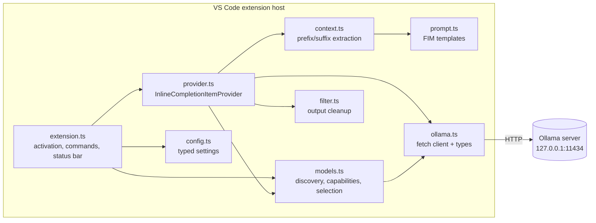
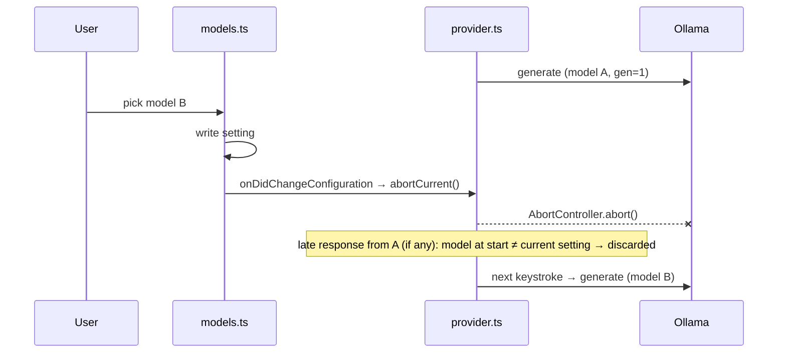

# Local Autocomplete — Technical Specification

A VS Code extension that shows Copilot-style inline ghost-text completions generated by a locally installed Ollama model. No cloud services, no backend, no telemetry.

Status legend used throughout:

- **[Confirmed]** — stated in official VS Code or Ollama documentation.
- **[Source]** — not in the API docs, but present in Ollama's source code or observed behavior. Must be validated at runtime, and the code must degrade gracefully if it is wrong.
- **[Assumption]** — a design guess to be validated by benchmarking or manual testing.

References: [VS Code API](https://code.visualstudio.com/api/references/vscode-api) (`InlineCompletionItemProvider`), [Ollama API](https://github.com/ollama/ollama/blob/main/docs/api.md), [Ollama Modelfile parameters](https://github.com/ollama/ollama/blob/main/docs/modelfile.md).

---

## 1. Project Overview

| Item | Value |
|---|---|
| Extension id | `local-autocomplete` |
| Display name | Local Autocomplete |
| Setting / command prefix | `localAutocomplete` |
| Language | TypeScript (strict) |
| Runtime | VS Code extension host (Node.js ≥ 22; native `fetch`, `AbortSignal.any`, `AbortSignal.timeout`) |
| Minimum VS Code | 1.101 (Node 22 extension host, required by current Vitest and `@types/node` peers; inline completion API stable since 1.68) |
| Inference | Ollama HTTP API, default `http://127.0.0.1:11434` |
| Build | esbuild → single `dist/extension.js` (CommonJS) |
| Tests | Vitest (unit), `@vscode/test-electron` (integration) |
| Lint | ESLint flat config + `typescript-eslint` |
| Package | `@vscode/vsce` → `.vsix`, installed locally |
| Runtime dependencies | **None.** Everything uses the VS Code API and Node built-ins. |

## 2. Goals and Non-Goals

### Goals

1. Fast, unobtrusive inline completions in any language VS Code opens.
2. Fully local: the only network peer is the configured Ollama endpoint.
3. Switch between installed Ollama models at runtime from a quick pick or the status bar.
4. FIM (fill-in-the-middle) when the model supports it; prefix-only fallback otherwise.
5. Never interrupt typing. Failures are silent except for a status-bar state and opt-in log lines.

### Non-Goals (v1)

Chat, agents or code execution, automatic edits, cloud providers, accounts or billing, hosted backends, automatic model downloads (`/api/pull` is never called), workspace indexing or embeddings, multi-file context, telemetry of any kind.

## 3. Requirements

### Functional

| ID | Requirement |
|---|---|
| F1 | Register an `InlineCompletionItemProvider` for documents with scheme `file`, `untitled` or `vscode-notebook-cell`. |
| F2 | Build the prompt from the prefix and suffix around the cursor, plus the language id and the workspace-relative path. |
| F3 | Use Ollama's native FIM (`suffix` field) when the model reports the `insert` capability. Otherwise use a built-in raw FIM template if one matches. Otherwise use prefix-only continuation. |
| F4 | Post-process the output: strip Markdown fences, trim prefix and suffix overlap, cap line count, and drop empty or whitespace-only results. |
| F5 | Discover models with `GET /api/tags`. Never hardcode the installed-model list. |
| F6 | Quick pick for model selection, persisted to user settings, effective immediately. |
| F7 | Status bar item shows the enabled state, the model, and offline or error state. Clicking it opens the model picker. |
| F8 | Commands: Enable, Disable, Select Model, Refresh Models, Test Connection, Open Settings. |
| F9 | Respect `CancellationToken`. Abort the HTTP request when the request is superseded, times out, the model switches, or the extension deactivates. |
| F10 | Skip completion for languages in `disabledLanguages` and when IntelliSense has a selected item (`context.selectedCompletionInfo`). |

### Non-functional

| ID | Requirement |
|---|---|
| N1 | At most **one** in-flight inference request at a time. |
| N2 | No source code or prompts in logs. Log metadata only: lengths, durations, model, status. |
| N3 | No synchronous file or network I/O on the extension host's hot path. |
| N4 | Activation time under 50 ms. No network calls during activation; model discovery is lazy. |
| N5 | Zero runtime npm dependencies. |

## 4. User Stories

1. *As a developer*, I type code and see a gray suggestion that completes the line or block. I press **Tab** to accept, **Ctrl/Cmd+→** to accept a word, or keep typing to ignore it.
2. *As a developer with several models*, I click the status bar, pick `deepseek-coder-v2:16b`, and the next suggestion comes from that model without a reload.
3. *As a developer*, when Ollama isn't running, typing is unaffected, and the status bar shows `$(warning) Ollama offline`. **Test Connection** tells me exactly what is wrong.
4. *As a developer*, I disable completions with one command when I'm writing prose or presenting.
5. *As a privacy-conscious developer*, I can verify that code only goes to my configured endpoint, and I am warned if that endpoint is not local.

## 5. Architecture



Dependencies point one way. `ollama.ts`, `config.ts`, `context.ts`, `prompt.ts` and `filter.ts` do not import `vscode`, so unit tests run in plain Node with no mocking. `models.ts`, `provider.ts` and `extension.ts` are the only modules that touch the VS Code API.

## 6. Component Responsibilities

| Module | Responsibility | Imports `vscode` |
|---|---|---|
| `extension.ts` | `activate`/`deactivate`, registers the provider and commands, owns the status bar item and the `LogOutputChannel`, reacts to `onDidChangeConfiguration`. | yes |
| `config.ts` | `readSettings(config)` turns any `get(key)` source (a `WorkspaceConfiguration` in practice) into a typed object with clamped values. Writes to `ConfigurationTarget.Global` happen in `models.ts`/`extension.ts`. | no |
| `ollama.ts` | Thin `fetch` wrapper: `listModels`, `showModel`, `generate`, `version`. Defines request and response types. Maps failures to `OllamaError` with `kind: 'connection' \| 'timeout' \| 'http' \| 'model-not-found' \| 'invalid-response' \| 'aborted'`. | no |
| `models.ts` | Caches the `/api/tags` result and per-model capabilities (`/api/show`, once per model per session). Exposes `select()` (quick pick), `refresh()`, `testConnection()`, and `report()`, which tracks the offline, error and missing-model state that drives the status bar. | yes |
| `context.ts` | `buildContext(text, offset, budget)` → `{ prefix, suffix }`. Cuts at line boundaries and gives 75% of the budget to the prefix. | no |
| `prompt.ts` | `buildRequest(ctx, profile, settings)` → the `/api/generate` body. Holds the built-in raw FIM template table. | no |
| `filter.ts` | `cleanCompletion(raw, ctx, opts)` → `string \| undefined`. | no |
| `provider.ts` | Debounce, skip rules, single-flight abort, stale checks, and building the `InlineCompletionItem`. | yes |

This is flatter than the structure proposed in the requirements: each concern is one file until it outgrows it. A `commands/` folder or a `templates/` directory adds indirection with no benefit at this size.

## 7. Ollama API Integration

Only these endpoints are used. All are **[Confirmed]** in `docs/api.md`.

| Endpoint | Use | When |
|---|---|---|
| `GET /api/version` | Connection test | Test Connection command |
| `GET /api/tags` | List installed models | First completion or picker open, Refresh, endpoint change, after a model-not-found error |
| `POST /api/show` | Read `capabilities`, `details.family`, `template` | Once per model per session (cached) |
| `POST /api/generate` | Inference | Each completion |
| `GET /api/ps` | Optional: show "loaded" in the picker | Picker open only |

Never used: `/api/pull`, `/api/delete`, `/api/create`, `/api/push`, `/api/chat`.

### Types (subset actually consumed)

```ts
interface TagsResponse { models: { name: string; model: string; modified_at: string; size: number; digest: string;
  details: { family: string; families?: string[]; parameter_size: string; quantization_level: string; format: string } }[] }

interface ShowResponse { template?: string; capabilities?: string[]; details?: { family?: string } }

interface GenerateRequest {
  model: string; prompt: string; suffix?: string; raw?: boolean; stream: false;
  keep_alive?: string | number;
  options?: { num_predict?: number; temperature?: number; num_ctx?: number; stop?: string[]; top_p?: number };
}
interface GenerateResponse { response: string; done: boolean; done_reason?: string;
  total_duration?: number; load_duration?: number; eval_count?: number; eval_duration?: number }
```

All fields not listed above are ignored. Response parsing validates `typeof response === 'string'` and treats anything else as `invalid-response`.

### Example: native FIM request

```http
POST /api/generate
{
  "model": "qwen2.5-coder:7b",
  "prompt": "// File: src/math.ts (typescript)\nexport function add(a: number, b: number) {\n  ",
  "suffix": "\n}\n",
  "stream": false,
  "keep_alive": "30m",
  "options": { "num_predict": 128, "temperature": 0.2, "num_ctx": 4096, "top_p": 0.9 }
}
→ { "response": "return a + b;", "done": true, "done_reason": "stop", "eval_count": 6, ... }
```

### Capability facts

- `capabilities` exists in `/api/show` **[Confirmed]**. The docs only show `"completion"` and `"vision"` as examples.
- `"insert"` means the model's template supports `suffix` (FIM). **[Source]** It is defined in Ollama's `types/model/capability.go`. Ollama rejects `suffix` for models without it (HTTP 400, "does not support insert"). Handling: if `capabilities` is missing (older Ollama), or a suffix request fails with 400, mark the model as `insert: false` for the session and retry once without `suffix`.
- `raw: true` sends the prompt verbatim without templating **[Confirmed]**. This is how the built-in FIM templates are used for models that support FIM tokens but lack the `insert` capability.

### Model residency and keep-alive

- Ollama loads a model on first request and unloads it `keep_alive` after its last request. The default is `5m` **[Confirmed]**. The extension sends `keep_alive` on every request (default `"30m"`), so the active model stays warm while you code and frees VRAM/RAM 30 minutes after you stop.
- Switching models needs **no manual unload**. The old model stays resident until its own keep-alive expires. Ollama may also evict it earlier under memory pressure or when `OLLAMA_MAX_LOADED_MODELS` is reached (server-side env, **[Confirmed]** in Ollama FAQ). Users who want to free memory immediately can set `keepAlive` to a short value. The extension never sends a `keep_alive: 0` unload request on its own.
- Cold-load latency (`load_duration`) can be seconds. The first request after a switch is allowed to exceed the timeout once (see §12).

## 8. Dynamic Model Selection

### Quick pick

`Local Autocomplete: Select Model` (also opened by clicking the status bar):

```
$(check) qwen2.5-coder:7b          7.6B · Q4_K_M · 4.7 GB
$(blank) deepseek-coder-v2:16b     15.7B · Q4_0 · 8.9 GB
$(blank) codegemma:2b              2B · Q4_0 · 1.6 GB
```

- Opening the picker fetches `/api/tags` fresh (one local call, only on user action), so the picker needs no separate Refresh item. `description` is built from `details.parameter_size`, `quantization_level` and `size`. A "loaded" marker from `/api/ps` was left out of v1.
- Embedding-only models (`/api/show` capabilities lacking `completion`) are not filtered out up front, because that would cost one `/api/show` per model. If one is selected, it fails on first use with a clear message. **[Assumption]**: lists are short enough that this is acceptable.
- No models installed: an information message says "No Ollama models installed. Run e.g. `ollama pull qwen2.5-coder:1.5b`." instead of an empty picker. The extension does not run the pull.
- A configured name without a tag matches `<name>:latest`, which is how Ollama resolves it.

### Switch behavior



1. Write `localAutocomplete.model` to `ConfigurationTarget.Global`. The `onDidChangeConfiguration` handler (so manual edits in settings.json behave the same) aborts the in-flight request and updates the status bar. Then call `editor.action.inlineSuggest.hide` so ghost text from the old model disappears.
2. The provider compares the model it started with against the current setting after the response arrives and drops the result if they differ. This replaced a generation counter: it is equivalent and needs no shared state.
3. If the configured model is missing from `/api/tags` (removed by the user), or generate returns 404 "model not found": set the status bar to `$(warning) <model> not found`. Show **one** notification per session with a **Select Model** button, and stop requesting until the setting changes. Never auto-switch.
4. If the model setting is empty on first run, completions are off. The status bar shows `$(sparkle) Select model`, and clicking it opens the picker.

### Capability profiles

The resolved profile per model is cached for the session and cleared by Refresh:

```ts
interface ModelProfile { insert: boolean; template?: FimTemplate; }
```

Resolution order:

1. `/api/show.capabilities` includes `"insert"` → `insert: true` (native suffix).
2. Otherwise, match the model name or `details.family` against the built-in raw templates in `prompt.ts`:

   | Match (name or family contains) | Template (`{p}` prefix, `{s}` suffix) | Stop |
   |---|---|---|
   | `qwen2.5-coder`, `qwen3-coder`, `codegemma` | `<\|fim_prefix\|>{p}<\|fim_suffix\|>{s}<\|fim_middle\|>` | `<\|endoftext\|>`, `<\|file_sep\|>`, `<\|fim_prefix\|>`, `<\|fim_suffix\|>`, `<\|fim_middle\|>` |
   | `deepseek-coder` | `<｜fim▁begin｜>{p}<｜fim▁hole｜>{s}<｜fim▁end｜>` | `<｜end▁of▁sentence｜>`, `<｜fim▁begin｜>`, `<｜fim▁hole｜>`, `<｜fim▁end｜>` |
   | `starcoder` | `<fim_prefix>{p}<fim_suffix>{s}<fim_middle>` | `<\|endoftext\|>`, `<fim_prefix>`, `<fim_suffix>`, `<fim_middle>` |
   | `codellama` | `<PRE> {p} <SUF>{s} <MID>` | `<EOT>`, `<PRE>`, `<SUF>`, `<MID>` |

   These token formats come from each model's published tokenizer and model card **[Source]**. Validate each one manually in Phase 5.
3. Otherwise → prefix-only: `raw: true`, prompt = file header comment + prefix, no suffix. Stop sequences: `\n\n\n`.

A user-facing override setting for templates is deliberately left out of v1 (see Open Questions).

Model capabilities (FIM support, context length) belong to the **model**. Debounce, filtering, cancellation, line caps and keep-alive belong to the **extension** and apply equally to every model.

## 9. Inline Completion Workflow

```mermaid
sequenceDiagram
  participant VS as VS Code
  participant P as provider
  participant O as Ollama
  VS->>P: provideInlineCompletionItems(doc, pos, ctx, token)
  P->>P: skip? (disabled, no model, language excluded, selectedCompletionInfo, offline backoff)
  P->>P: await debounce(debounceMs, token)
  alt token cancelled
    P-->>VS: undefined
  end
  P->>P: buildContext → buildRequest
  P->>P: abort previous controller; new AbortController(token, timeout)
  P->>O: POST /api/generate
  O-->>P: response
  P->>P: stale? (token cancelled, model setting changed)
  P->>P: cleanCompletion
  P-->>VS: [InlineCompletionItem(text, Range(pos,pos))]
```

Skip rules, checked before the debounce and costing no I/O:

- `enabled === false`, or no model selected, or the model is marked missing.
- `document.languageId` in `disabledLanguages`.
- `context.selectedCompletionInfo !== undefined`. The IntelliSense widget has a selection, and a ghost suggestion would conflict. **Trade-off:** fewer inline suggestions while the suggest widget is open, in exchange for zero interference with language servers.
- Offline backoff: after a `connection` error, skip all requests for 10 s. The status bar shows offline, and the next attempt after the window re-probes.
- Mid-word heuristic: if the character right after the cursor is a word character (`\w`), skip. Completing inside an identifier is almost always wrong.

Acceptance and dismissal use VS Code's built-in keybindings: Tab (`editor.action.inlineSuggest.commit`), Ctrl/Cmd+→ (`acceptNextWord`), Esc (`hide`), Alt+\ (`trigger`, manual invoke).

## 10. Prompt and Context Strategy

### Context

- Source: the current document only. No other files and no workspace scan.
- Budget: `maxContextChars` (default 6000 ≈ 1.5k tokens). The prefix gets up to 75%, the suffix the rest. Unused suffix budget goes back to the prefix.
- Cut at line boundaries: the prefix starts at a line start and the suffix ends at a line end.
- Header: a one-line comment in the language's line-comment style, falling back to `//`: `<comment> File: <workspace-relative path> (<languageId>)`. It is prepended to the prefix. A relative path keeps the absolute path (username, folder layout) out of the prompt.
- Imports and declarations: v1 relies on the prefix window, which already covers the top of most files under ~150 lines. **Phase 3 (done):** if the prefix window starts below line 0, prepend the file head up to the last line matching `^(import|from|#include|using|require|use)\b` within the first 50 lines. Taking the whole head, rather than only the matching lines, keeps multi-line imports intact. The block counts against the prefix budget and is skipped entirely if it exceeds 25% of the budget, never cut mid-import. The import pattern is a heuristic and its value must be measured.
- `num_ctx` (default 4096) must exceed the prompt tokens plus `maxTokens`. With the defaults, 6000 chars ≈ 1.5–2k tokens + 128 output fits easily.

### Single- vs multi-line

- If the cursor line has non-whitespace text **after** the cursor → single-line mode: add `\n` to the stop sequences.
- Otherwise multi-line, capped at **15 lines** by the filter. This is a constant, not a setting.

### Output cleanup (`filter.ts`)

Applied in order, each conservative:

1. If the output is a Markdown fence block (` ```lang\n…\n``` `), take its body. If only an opening or closing fence is present, remove just that fence line. Never touch backticks inside code.
2. Strip a leading copy of the prefix's last line when the model repeats it (exact-match overlap only).
3. Trim trailing overlap with the suffix: find the longest suffix of the completion, ≥ 3 chars, that equals a prefix of the document suffix after leading whitespace, and cut it. Exact match only.
4. Drop leading text that looks like prose, for all models since the match is this narrow. Only when the first line starts with `Here`, `Sure`, `This ` or `The following` and ends with `:`, drop that line. Nothing broader.
5. If `done_reason === 'length'` and there is more than one line, drop the last line, which is likely partial. Then cap at 15 lines (1 in single-line mode).
6. `trimEnd()` the result. If it is empty or whitespace-only → `undefined`. Leading indentation is never modified.

## 11. Performance Requirements

Targets **[Assumption]**, to be validated with the benchmark below:

| Metric | Target (GPU, ≤7B Q4) | Target (CPU-only, ≤1.5B Q4) |
|---|---|---|
| Debounce | 250 ms (configurable) | 250 ms |
| Request → suggestion shown (warm model, p50) | ≤ 700 ms | ≤ 2000 ms |
| Request → suggestion shown (warm, p95) | ≤ 1500 ms | ≤ 4000 ms |
| Cold load (first request after switch) | not budgeted; may time out once | — |
| Extension overhead (context + filter) | ≤ 5 ms | ≤ 5 ms |
| Provider calls → Ollama requests | ≤ 1 per debounce window, 1 in flight | same |

Inline completions only show once fully generated, so "first usable suggestion" and "complete suggestion" are the same moment. Non-streaming (`stream: false`) is used. Streaming would only help if we stopped early at the line cap. That is a Phase 4 option if `eval_duration` shows wasted tokens.

**Measurement:** with the output channel at Debug level (`Developer: Set Log Level…`), the output channel logs one line per request: `model, prompt_chars, total_ms, load_ms, eval_count, tok_s, done, outcome` (`shown`/`empty`/`stale`). `npm run bench -- <model> [<model>…]` (`scripts/bench.ts`, bundled by esbuild) replays 20 prompts against a running Ollama and prints p50/p95, tokens/s and the empty count. The prompts come from this repo's `src/` files, with the cursor at the end of lines 30%, 60% and 90% through each file. Optional; it never runs in CI.

**Measured (2026-11-01, warm, `bench`):**

| Model | Path | p50 | p95 | tok/s | Empty |
|---|---|---|---|---|---|
| `qwen2.5-coder:7b` | native FIM | 418 ms | 2126 ms | 73.8 | 2/20 |
| `qwen2.5-coder:1.5b` | native FIM | 115 ms | 682 ms | 209.2 | 8/20 |

An earlier 7b-only run measured p50 772 ms and p95 3809 ms, so single runs vary noticeably. The 7b meets the p50 target and misses the p95 target. The 1.5b meets both, but gives up quality: four times as many empty completions. Every fixture is a different file, so Ollama's prompt cache never hits, while real typing reuses most of the previous prompt. Treat these as pessimistic. Re-measure with a second model and in real use (debug log) before tuning `maxTokens` or adding streaming.

**Trade-offs:** 1.5B models are fast enough for CPU but weaker at multi-line. 7B models are a good GPU default. 14B+ usually exceeds the latency budget for typing-speed completion. Recommend `qwen2.5-coder:1.5b` (CPU) or `qwen2.5-coder:7b` (GPU) in the README.

## 12. Cancellation and Concurrency

| Event | Mechanism |
|---|---|
| Continued typing, cursor move, document edit | VS Code cancels the previous call's `token` and calls the provider again **[Confirmed]**. The debounce sleep resolves early on cancellation. `token.onCancellationRequested` → `controller.abort()`. |
| Newer request starts | The provider keeps one module-level `AbortController` and aborts it before starting a new one (single-flight). |
| Timeout | `AbortSignal.any([controller.signal, AbortSignal.timeout(timeoutMs)])`. Exception: if this model has had no successful request in the last 5 minutes (including the first request of a session and after a switch), use `max(timeoutMs, 30000)` to allow a cold load. A long timeout costs nothing while typing, because the next keystroke cancels the request anyway. |
| Ollama offline | After a `connection` error, the provider skips requests for 10 s (before the debounce, no I/O). A success, Refresh, Test Connection or an endpoint change clears the pause. |
| Model switch | The config-change handler calls `provider.abortCurrent()`. A result whose starting model differs from the current setting is dropped. |
| Editor closed | Its token is cancelled by VS Code → abort. |
| Deactivate | `deactivate()` aborts the current controller. All disposables are registered in `context.subscriptions`. |
| Stale result | After `fetch` resolves, discard if `token.isCancellationRequested` or the model setting changed. (`document.version` is covered by the token: VS Code cancels on every edit.) |

**HTTP abort vs inference stop.** Aborting the `fetch` closes the TCP connection. Ollama's server ties generation to the request context and stops generating when the client disconnects **[Source]**: the Go handler checks `ctx.Done()`. This is not guaranteed by the API docs. **Validated 2026-11-01 (Ollama 0.40.13, `qwen2.5-coder:7b`):** a 1500-token generation took 23.6 s to completion. The same request aborted after 1.5 s was logged by the server as ending at 1.51 s (status 500), and the runner logged `stop: cancel task`. Re-check after major Ollama upgrades. If it is ever not honored, the single-flight rule still caps server load. Ollama queues requests per model (`OLLAMA_NUM_PARALLEL`), so a leaked generation delays at most the next request by its remaining `num_predict` tokens.

## 13. Configuration Schema

All settings live under `localAutocomplete.*` in `package.json` `contributes.configuration`. `config.ts` clamps out-of-range numbers to the stated bounds. It does not throw.

| Setting | Type | Default | Bounds / validation | Scope | Description |
|---|---|---|---|---|---|
| `enabled` | boolean | `true` | — | `window` | Master switch. Toggled by the Enable/Disable commands. |
| `endpoint` | string | `http://127.0.0.1:11434` | Must parse as an `http:`/`https:` URL, else treated as invalid (status bar error). Trailing `/` stripped. | **`machine`** | Ollama base URL. |
| `model` | string | `""` | Free text; validated against `/api/tags` lazily. | **`machine`** | Ollama model name, e.g. `qwen2.5-coder:7b`. |
| `requestTimeoutMs` | integer | `5000` | 500–60000 | `window` | Abort inference after this long. |
| `debounceMs` | integer | `250` | 0–2000 | `window` | Delay after the last keystroke before requesting. |
| `maxTokens` | integer | `128` | 1–1024 | `window` | `options.num_predict`. |
| `temperature` | number | `0.2` | 0–2 | `window` | `options.temperature`. |
| `maxContextChars` | integer | `6000` | 500–100000 | `window` | Characters of prefix + suffix sent to the model. |
| `numCtx` | integer | `4096` | 512–131072 | `window` | `options.num_ctx` (model context window). |
| `keepAlive` | string | `"30m"` | Ollama duration string (`"30m"`, `"1h"`) or `"-1"` (forever) | `window` | `keep_alive` sent with each request. |
| `disabledLanguages` | string[] | `["plaintext", "markdown", "scminput"]` | Language ids | `window` | No completions in these languages. |

Fixed internally, not settings: `top_p: 0.9`, the 15-line cap, the 75/25 prefix split, and the 10 s offline backoff.

### Precedence and security

VS Code resolves Default < User < Workspace < Workspace Folder **[Confirmed]**. A cloned repository's `.vscode/settings.json` could otherwise redirect `endpoint` to an attacker's server and exfiltrate code, which makes `endpoint` security-sensitive. Its scope is `machine`, so VS Code ignores it in workspace settings and only honors user (or remote-machine) settings **[Confirmed]**. `model` is also `machine`-scoped. Installed models are a property of the machine, which also keeps the Select Model command's write to user settings from being shadowed by a workspace value. Machine-scoped settings are also not synced by Settings Sync, which is correct here because model lists differ per machine.

## 14. Privacy and Security

- **Single network peer:** `ollama.ts` is the only module that calls `fetch`, and every URL is built from `endpoint`. Enforced by an ESLint `no-restricted-globals`/`no-restricted-syntax` rule banning `fetch` outside `ollama.ts`.
- **No telemetry:** no analytics or crash-reporting dependencies. Zero runtime dependencies makes this auditable. `package.json` sets no telemetry-related contributions.
- **Non-local endpoint warning:** a host that is not `localhost`, `127.0.0.0/8` or `::1` gets one warning per session per endpoint. The warning reads: "Code will be sent to <host>. Only use endpoints you control." It offers **Keep** and **Reset to localhost** buttons. If the scheme is `http:` and the host is non-local, the warning also says traffic is unencrypted.
- **Logging:** a `LogOutputChannel` (`window.createOutputChannel(name, { log: true })`) logs metadata only. Prompts, completions, file contents and absolute paths are never logged. Error messages from Ollama are logged, truncated to 200 chars, because they may echo request content.
- **Prompt content:** the prompt carries the workspace-relative path, never the absolute path. Untitled documents send `Untitled-1`.
- **Exclusions:** `disabledLanguages` covers prose. Users with secret files (e.g. `.env`) should add their language id (`dotenv`, `properties`). The README documents this. A glob-based exclusion is an Open Question.

## 15. Error Handling

Typing is never blocked. Inside `provideInlineCompletionItems`, every failure returns `undefined`.

| Condition | Detection | Status bar | Notification | Log |
|---|---|---|---|---|
| Ollama not installed / not running | `fetch` rejects (`ECONNREFUSED`) → `connection` | `$(warning) Ollama offline` | Only from Test Connection / Select Model: "Can't reach Ollama at <url>. Is `ollama serve` running?" | warn, once per transition |
| Invalid endpoint | `new URL()` throws or wrong scheme | `$(error) Invalid endpoint` | Once per change, with **Open Settings** | error |
| No installed models | `/api/tags` returns `[]` | `$(sparkle) Select model`, or `<model> not found` if one is set | From Select Model only (see §8) | — |
| Selected model removed | Absent from tags, or generate 404 | `$(warning) <model> not found` | Once per session, **Select Model** button | warn |
| Model lacks insert | Not reachable: `suffix` is only sent when `/api/show` reports `insert`, and a missing `capabilities` field counts as no insert | — | — | — |
| Timeout | `TimeoutError` from `AbortSignal.timeout` | unchanged | none | debug |
| HTTP 5xx / other 4xx | `!res.ok` | `$(warning) Ollama error` until the next success | none | warn with status and truncated body |
| Invalid response | Non-JSON or missing `response` string | unchanged | none | warn |
| Cancellation | `AbortError` or token cancelled | unchanged | none | none |
| Disabled / excluded language | Skip rules | unchanged | none | none |
| Empty completion | Filter returns `undefined` | unchanged | none | debug |

A successful request resets the status bar to normal. State transitions are logged, but repeats of the same failure are not.

## 16. Testing Strategy

| Layer | Tool | What | Needs Ollama |
|---|---|---|---|
| Unit | Vitest | `context.ts` (budget, line cuts, header, split rebalance), `prompt.ts` (native vs raw template vs prefix-only bodies, stop tokens, single-line `\n`), `filter.ts` (each rule, plus "valid code is left untouched" cases), `config.ts` clamping (`readSettings` with a stub source) | no |
| Mocked API | Vitest + stubbed `globalThis.fetch` | `ollama.ts` error mapping (refused, timeout, 404, 400 insert, 500, bad JSON), abort propagation, request body shape | no |
| Concurrency (`test/provider.test.ts`) | Vitest, deferred `fetch` stub, `vscode` aliased to `test/vscode.ts` | single-flight abort, model change drops the result, debounce collapses N calls into 1, offline backoff, cold-model tracking | no |
| Integration (`test/integration/`, `npm run test:integration`) | `@vscode/test-electron` (downloads VS Code into `.vscode-test/` once), plain `node:assert` | Activation, commands registered, ghost text accepted via `editor.action.inlineSuggest.commit` against a fake Ollama (Node `http`, random port) serving `/api/tags`, `/api/show`, `/api/generate`; the generate body carries the suffix and no absolute path | no (fake server) |
| Manual / optional | `npm run bench`, checklist below | Real models: `qwen2.5-coder:1.5b`, `qwen2.5-coder:7b`, `deepseek-coder:6.7b`, `codegemma:2b`, one non-code model (prefix-only path) | yes |

`models.ts` and `provider.ts` are tested with the real classes. `vitest.config.ts` aliases `vscode` to `test/vscode.ts`, a stub with only the members those modules touch (`Range`, `InlineCompletionItem`, `workspace.getConfiguration`, `window.showWarningMessage`). Extend the stub only when a test needs it. Don't mock the whole API.

`@vscode/test-cli` (and its Mocha) was left out: one suite with a `run()` export needs no test framework. The launcher deletes `ELECTRON_RUN_AS_NODE`, which terminals inside VS Code set and which makes `Code.exe` reject the launch arguments.

Manual checklist per model: completes a function body; completes mid-line with a suffix present (no duplicated closing paren); imports; switching models mid-generation shows no old-model ghost text; stopping Ollama mid-session leaves typing smooth and shows the status bar offline; restarting Ollama recovers without a reload.

## 17. Project Structure

```
.
├── .claude/settings.json     # Claude Code project permissions
├── .vscode/                  # launch.json (Run Extension), tasks.json (watch)
├── CLAUDE.md                 # agent instructions (imports ponytail skill)
├── README.md                 # user docs, shipped in the .vsix
├── CHANGELOG.md              # shipped in the .vsix
├── LICENSE                   # MIT, shipped in the .vsix
├── docs/
│   ├── spec.md               # this file
│   ├── spec-prompt.md        # original spec request
│   └── milestones/           # one file per finished roadmap phase
├── package.json              # manifest: contributes.commands / configuration
├── tsconfig.json
├── esbuild.mjs
├── eslint.config.mjs
├── src/
│   ├── extension.ts
│   ├── config.ts
│   ├── ollama.ts
│   ├── models.ts
│   ├── context.ts
│   ├── prompt.ts
│   ├── filter.ts
│   └── provider.ts
├── output/                   # npm run package writes the .vsix here (gitignored)
├── vitest.config.ts          # aliases `vscode` to the test stub
├── test/                     # *.test.ts (Vitest), vscode.ts stub, integration/ (run.ts launcher, suite.ts)
└── scripts/bench.ts          # latency benchmark, `npm run bench -- <model>`
```

## 18. Development and Packaging

| Task | Command |
|---|---|
| Install | `npm install` |
| Build (one-shot) | `npm run build` (esbuild, sourcemaps) |
| Watch | `npm run watch` |
| Type check | `npm run typecheck` (`tsc --noEmit`; esbuild does not type-check) |
| Lint | `npm run lint` |
| Unit tests | `npm test` |
| Integration tests | `npm run test:integration` (no Ollama needed) |
| Benchmark (optional, needs Ollama) | `npm run bench -- <model> [<model>…]` |
| Debug | F5 in VS Code → "Run Extension" launch config (Extension Development Host) |
| Package | `npm run package` → `vsce package --no-dependencies --out output/` → `output/local-autocomplete-<version>.vsix` (`output/` is gitignored) |
| Install locally | `code --install-extension output/local-autocomplete-<version>.vsix`, or `npm run install:ext` (package + install/update with `--force`) |
| Uninstall | `npm run uninstall:ext` (`code --uninstall-extension linard-creative.local-autocomplete`) |

`vsce` needs `publisher`, `repository` and a `LICENSE`. `package.json` uses `"publisher": "linard-creative"`, the GitHub repository and the MIT `LICENSE`. Marketplace publishing is never required.

Versioning: SemVer in `package.json`. Bump the minor version per phase and the patch version for fixes. Keep a short `CHANGELOG.md` from Phase 5.

## 19. Implementation Roadmap

| Phase | Deliverables | Depends on | Acceptance |
|---|---|---|---|
| **1. Basic autocomplete** | Scaffold; `config.ts`, `ollama.ts` (`generate`, `showModel`), `context.ts`, `prompt.ts` (native suffix + prefix-only), minimal `filter.ts` (fences, empty), `provider.ts` with debounce + token abort; model from settings | — | With `model` set in settings and Ollama running, ghost text appears in a `.ts` file and Tab accepts it. Unit tests for context and filter pass. |
| **2. Model management** | `models.ts` (quick pick, capability cache, offline/missing state), status bar, all six commands, missing-model handling, non-local endpoint warning, single-flight abort (done early: needed for abort-on-switch) **[Done in 0.2.0]** | 1 | Switching models from the status bar takes effect on the next suggestion without a reload. The setting persists across restart. A removed model shows one notification. |
| **3. Completion quality** | Raw FIM template table, single/multi-line mode, full filter rules, import-block context, mid-word skip, `selectedCompletionInfo` skip **[Done in 0.3.0]** | 1 | Mid-line completions don't duplicate the suffix (manual checklist). Filter unit tests cover every rule, including untouched valid code. |
| **4. Reliability and performance** | Timeout + cold-load allowance, offline backoff, error mapping per §15, debug metrics line, `scripts/bench.ts` **[Done in 0.4.0]** | 1–2 | Concurrency tests pass. With Ollama stopped, typing in a 2k-line file shows no lag and no notifications. Bench p50 is recorded for 2+ models. HTTP-abort-stops-inference is validated (§12). |
| **5. Testing and packaging** | Mocked-API tests, integration tests with a fake server, README (setup, recommended models, privacy, troubleshooting), CHANGELOG, `.vsix` **[Done in 0.5.0]** | 1–4 | `npm test` and the integration tests pass with no Ollama installed. The `.vsix` installs and works in a clean VS Code profile. The manual checklist passes on 3+ models. |

## 20. Acceptance Criteria (critical workflows)

1. **First run:** install the `.vsix` with Ollama running and no model set → the status bar shows `Select model` → click → pick → the next pause in typing shows a suggestion.
2. **Accept:** Tab inserts exactly the ghost text. Esc dismisses it. Typing a matching character keeps the suggestion. Typing a different one hides it.
3. **Switch:** with model A generating, switch to B → no suggestion from A appears, and the next suggestion's log line shows B.
4. **Offline:** stop Ollama → typing is unaffected and the status bar shows offline within one request. No notification appears unless a command is run. Start Ollama → recovery within 10 s of the next keystroke.
5. **Disabled:** Disable → no requests sent (verified in the debug log). Enable → resumes.
6. **Privacy:** with the output channel at Debug level, the output channel contains no source text. The endpoint `http://192.168.1.5:11434` in user settings triggers the warning once. The same value in workspace settings is ignored.
7. **Removed model:** `ollama rm` the selected model → one notification with Select Model, then silence.

## 21. Technical Risks and Trade-offs

| Risk | Impact | Mitigation |
|---|---|---|
| `insert` capability semantics change or are absent in older Ollama | FIM silently off | Fallback chain (§8), retry without suffix on 400 |
| Raw FIM token formats wrong for some tags | Garbage output | Native suffix preferred; raw templates validated manually; prefix-only fallback |
| Instruct-tuned models chat instead of completing | Prose in suggestions | Prefer FIM paths; conservative prose filter; recommend `-coder` / base models |
| HTTP abort does not stop inference | Wasted compute, queued latency | Single-flight + small `num_predict`; validate in Phase 4 |
| Skipping while IntelliSense has a selection | Fewer suggestions | Deliberate. Revisit by completing on top of `selectedCompletionInfo.text` |
| Non-streaming waits for all tokens | Higher latency for long outputs | `num_predict` 128 and the line cap; streaming with early stop as a Phase 4 option |
| Cold model load exceeds timeout | First suggestion missing after a switch | One-time extended timeout (§12); keep-alive 30m |

## 22. Open Questions

1. Should a `modelOverrides` setting (per-model template, stop tokens, `num_ctx`) be added once real models show gaps in the built-in profiles?
2. Glob-based file exclusion (e.g. `**/.env*`) instead of, or in addition to, language ids?
3. Per-workspace model selection. It is currently `machine`-scoped for simplicity and security.
4. Should completions combine with an open IntelliSense selection (`selectedCompletionInfo`) instead of skipping?
5. Is streaming with early termination worth it, based on Phase 4 `eval_count` data?
6. Is the leading-imports context heuristic (Phase 3) measurably better than the plain prefix window?
